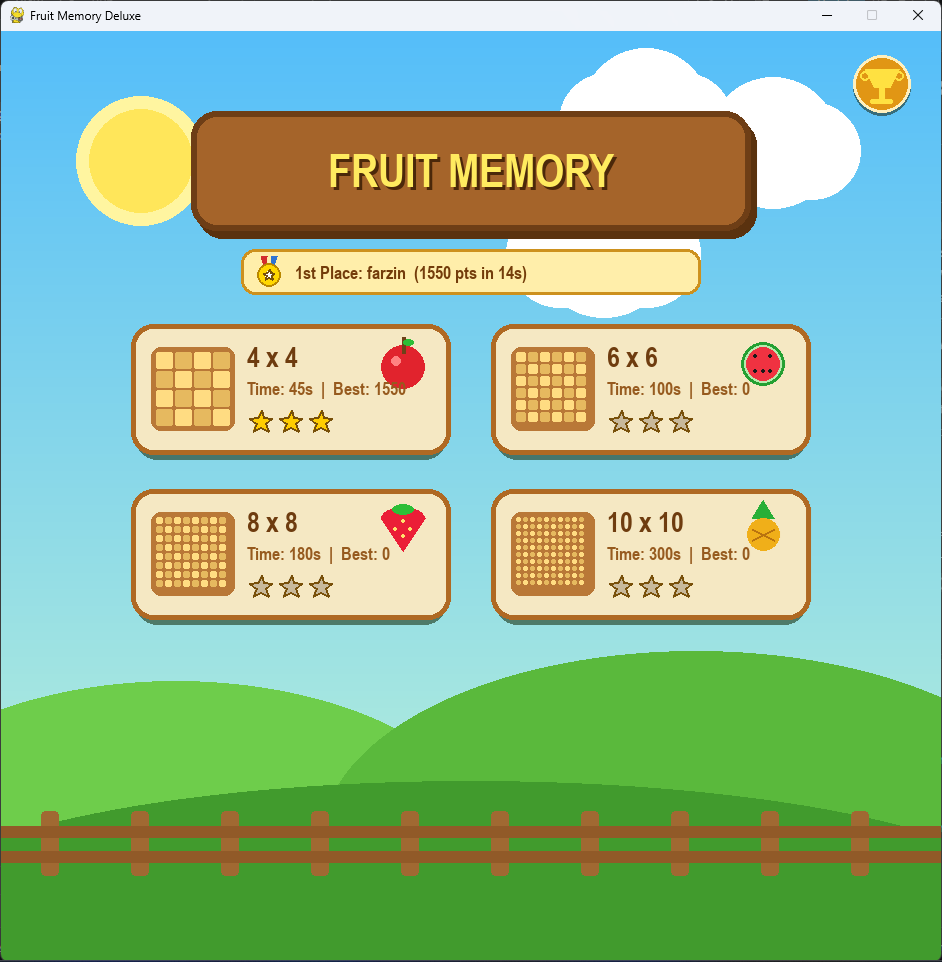
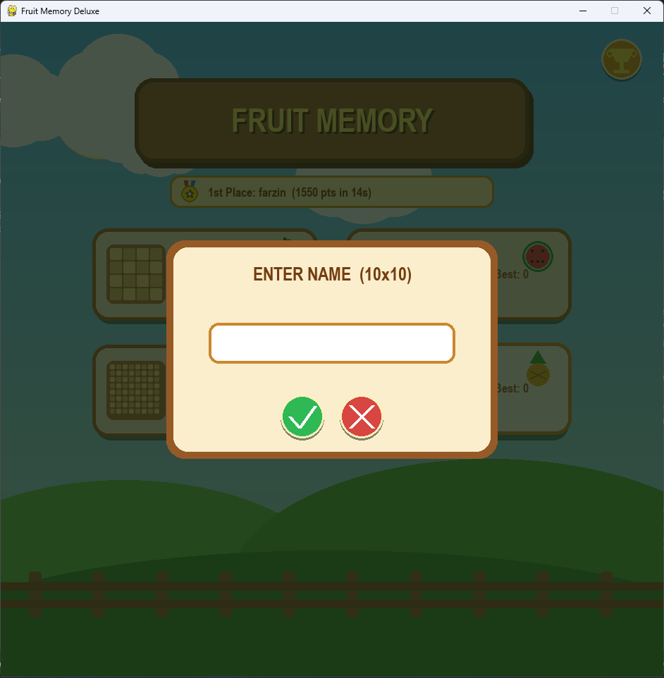
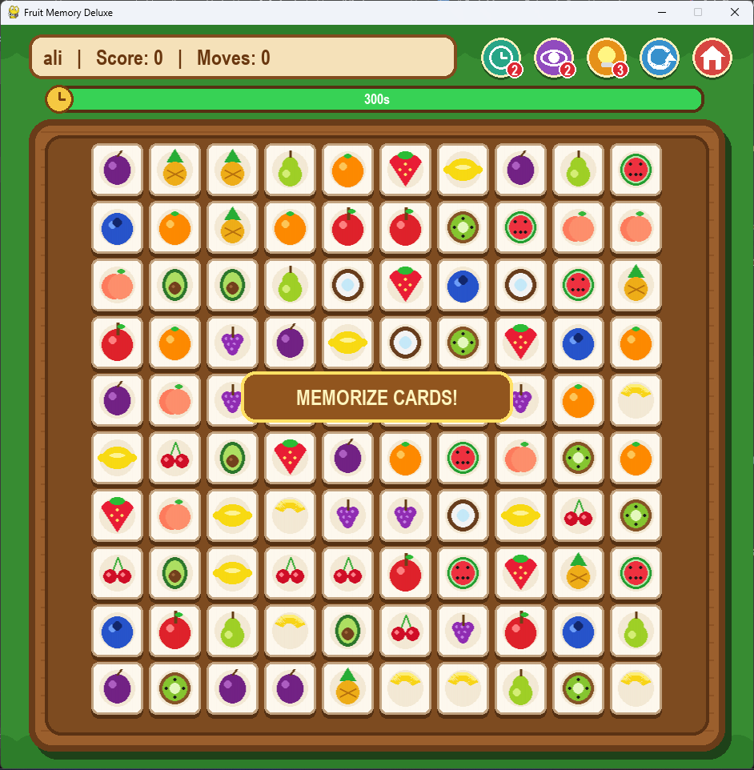
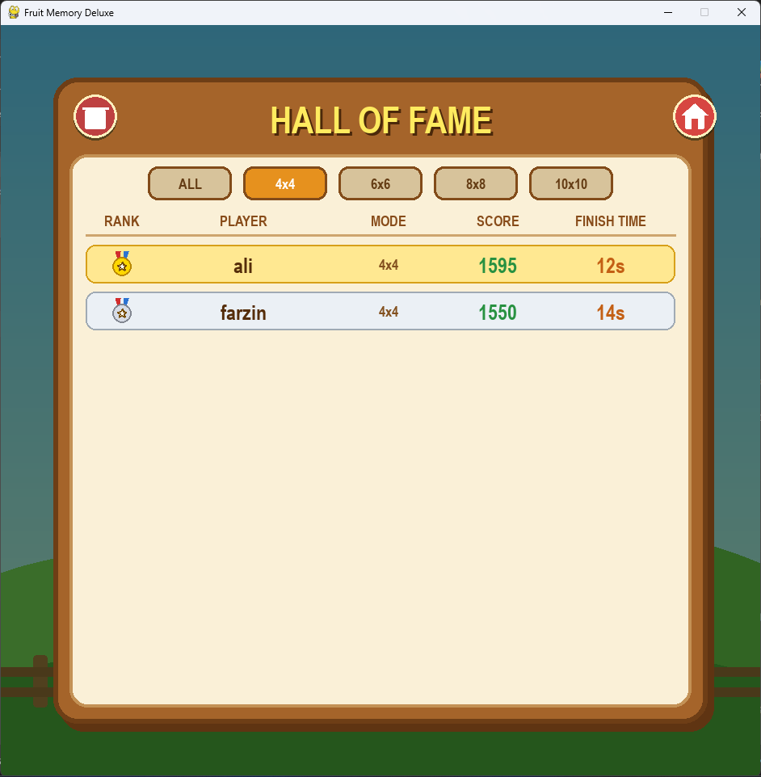

# Fruit Memory Deluxe in Python

## introduction
When we run `fruit-memory-game.py` on the computer it opens a 940x930 window using `pygame`. There is no need to use external files. When the window opens the game starts in the state `self.state = "menu"`. We have 4 level cards for 4x4, 6x6, 8x8 and 10x10 grids. You can type your name into `self.player_name` up to 14 letters in `self.state = "name_input"`. After clicking `btn_name_ok` the state goes to `self.state = "playing"` with the timer bar and the `self.cards` list where 16 fruits are drawn with `draw_fruit_graphic()`.

In `self.state = "playing"` clicking on a card checks `not card.revealed and not card.matched`. If it is closed the code flips it and adds it to `self.selected`. When all cards match up we get `self.won = True` and `save_record()` writes the score in `leaderboard.json`.

## Screenshots

### Main Menu


### Enter Player Name


### Game Screen


### Hall of Fame (Scoreboard)


## Features

Here are the main classes and functions in `fruit-memory-game.p` that run the board, power-ups and scoreboard.

`SAVE_FILE`. `self.records`: This keeps the top 50 scores inside `leaderboard.json`. In `load_records()` and `save_record()` the code sorts players by `(-r["score"], r["time"])` and updates `self.best_scores` and `self.best_stars`.

`draw_scoreboard()`. `draw_medal()`: Clicking `btn_menu_trophy` sets `self.state = "scoreboard"` to show the Hall of Fame. You can filter by `ALL`, `4x4`, `6x6`, `8x8` or `10x10`, and `btn_board_clear` deletes `leaderboard.json`.

Card flip. Combo points: When you click two cards in `self.selected` and `c1.fruit == c2.fruit`, both cards get `matched = True`. Each match gives `100 * self.combo` points, spawns 28 `Particle` circles with `spawn_burst()`, and if `self.combo > 1` it adds `+2.0` seconds to `self.time_left`.

Clock button. Time boost: In `use_time_boost()` you have 2 boosts (`self.time_boosts = 2`). Clicking the green clock icon adds `+15.0` seconds to `self.time_left` and shows a `FloatingText` on the screen.

Eye button. Peek cards: In `use_peek()` you have 2 peeks (`self.peeks_left = 2`). Clicking the purple eye icon sets `self.preview_until` to `now + 1400` so all unmatched cards flip open for 1.4 seconds.

`use_hint()`. `self.hints_left`: In `use_hint()` you have 3 hints (`self.hints_left = 3`). Clicking `btn_hint` sets `hint_timer = 95` on two matching cards so they get a yellow border.

## How To Use

When we run this code it starts pygame using `pygame.init()`. It opens a game window with `pygame.display.set_mode((WIDTH, HEIGHT))`. First open your command prompt or terminal. If you do not have pygame installed on your computer you must install it using pip. Then run `fruit-memory-game.py` in the terminal.

```
pip install pygame

python fruit-memory-game.py
```

At first the window opens in the state `self.state = "menu"`. You can set your name and start a level using the mouse or keyboard.

Click on level card: To pick between the 4x4, 6x6, 8x8 and 10x10 boards click on one of the 4 cards on the menu screen.

Type. Backspace: In `self.state = "name_input"` just type letters, up to 14 characters. To delete letters press the BACKSPACE key. Press ENTER or click the green check button to start.

Trophy or Trash button: To open `self.state = "scoreboard"` click the yellow trophy button. To clear all saved scores click the red trash button.

In the game screen, where `self.state = "playing"` you match pairs using the mouse and keyboard.

Left click on cards: To flip a fruit card on the board click on it. When 2 cards match the code adds `100 * self.combo` to `self.score`.

Clock, Eye or Bulb buttons: On the top right of the screen click `btn_time` for `+15s`, `btn_peek` to see all cards, or `btn_hint` to highlight 2 matching cards.

Press R or Reload button: When you want to play again, press the R key. Or click `btn_restart` to reset the board.

Press M key: To return to `self.state = "menu"` and change the grid size press the M key.